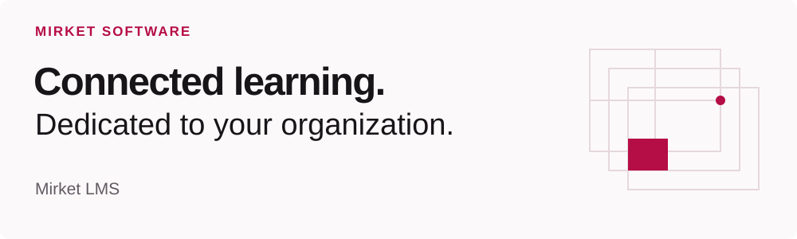

<picture>
  <source media="(max-width: 600px) and (prefers-color-scheme: dark)" srcset="https://raw.githubusercontent.com/codemirket/.github/main/profile/assets/header-mobile-dark.svg">
  <source media="(max-width: 600px)" srcset="https://raw.githubusercontent.com/codemirket/.github/main/profile/assets/header-mobile-light.svg">
  <source media="(prefers-color-scheme: dark)" srcset="https://raw.githubusercontent.com/codemirket/.github/main/profile/assets/header-dark.svg">
  
</picture>

Mirket Software builds Mirket LMS, a dedicated learning management platform. Founded by [Nazmi Yılmaz](https://github.com/nazmirket) in Antalya, Türkiye.

## Mirket LMS

**Everything learning needs. Connected.**

Mirket LMS brings course work, assessment, collaboration, and administration into one environment dedicated to your organization. Run it on your infrastructure or choose a dedicated instance managed by Mirket. The first production release is in preparation; see mirket.dev for current availability.

[Explore Mirket LMS →](https://mirket.dev)

## How we build

We work across the whole product: architecture, application development, integrations, infrastructure, and delivery. Our focus is practical software with clear responsibilities and maintainable systems.

---

[mirket.dev](https://mirket.dev) · [LinkedIn](https://www.linkedin.com/company/codemirket/) · [Contact Mirket](mailto:nazmi.yilmaz@mirket.dev)
